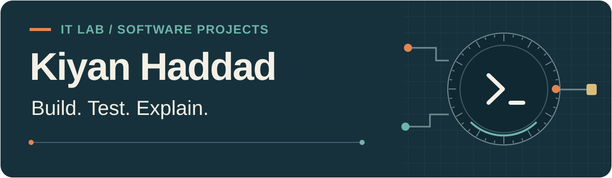
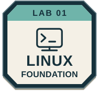
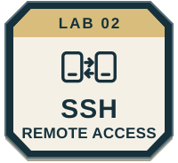
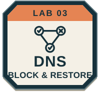

<picture>
  <source media="(max-width: 600px)" srcset="assets/banner-mobile.svg">
  
</picture>

I build useful services, test how they behave, and document the result. My current focus is a hands-on IT lab, alongside software projects.

**Used in this lab**

  
  
  
  
  

## Lab milestones

Custom project milestones from guided work. **Each patch opens real evidence.** These represent project results, not vendor certifications or GitHub achievements.

  
  
  

## Selected work

### [HomeLab](https://github.com/KiyanHaddad/HomeLab)

**Linux service · Guided build**

A Pi-hole DNS service administered over SSH. The completed test follows an **allowed → blocked → restored** request, with client results, server-side reasons and sanitized proof.

[Project report](https://github.com/KiyanHaddad/HomeLab/blob/main/docs/pi-hole-project-report.md) · [DNS evidence](https://github.com/KiyanHaddad/HomeLab/blob/main/evidence/images/dns-cycle.png)

### [Book Tracker](https://github.com/KiyanHaddad/Book-Tracker-Springboard-Software-Engineering-Capstone)

**React / Express / MongoDB · Springboard capstone**

Book search and saved favorites. Setup instructions are under review; runtime was not tested in this portfolio audit. Login/signup is demonstration UI.

### [KiFoundry Home](https://github.com/KiyanHaddad/kifoundry-home)

**Python · Development alpha**

A local RPG town for AI conversations and saved drafts. Its repository includes demo instructions and limitations; runtime was not verified in this audit.

## Next on the bench

**Desktop DNS pilot — in progress.** Browser/VPN behavior, ordinary applications and rollback remain to be checked. Backup restore is also future work.

Future network isolation, systems, security, automation and cloud builds will become separate projects when there are results to show.

How I record progress

The lab reports distinguish my actions, assistance received, captured results and pending checks. I keep authentic history and publish meaningful milestones. Earlier programming exercises remain available as learning history.

